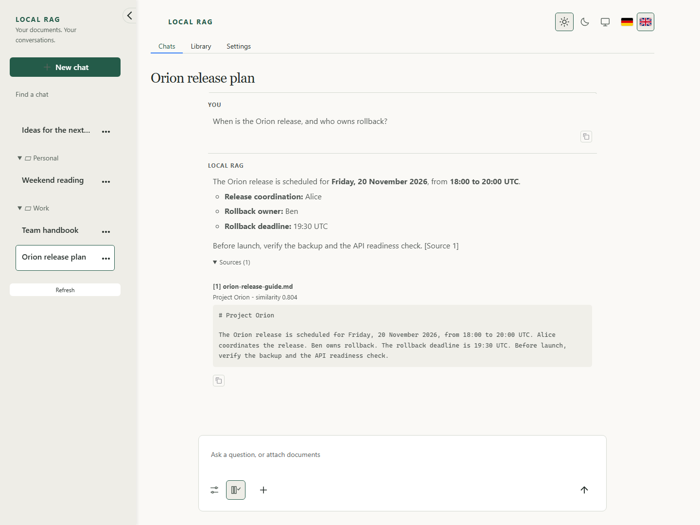
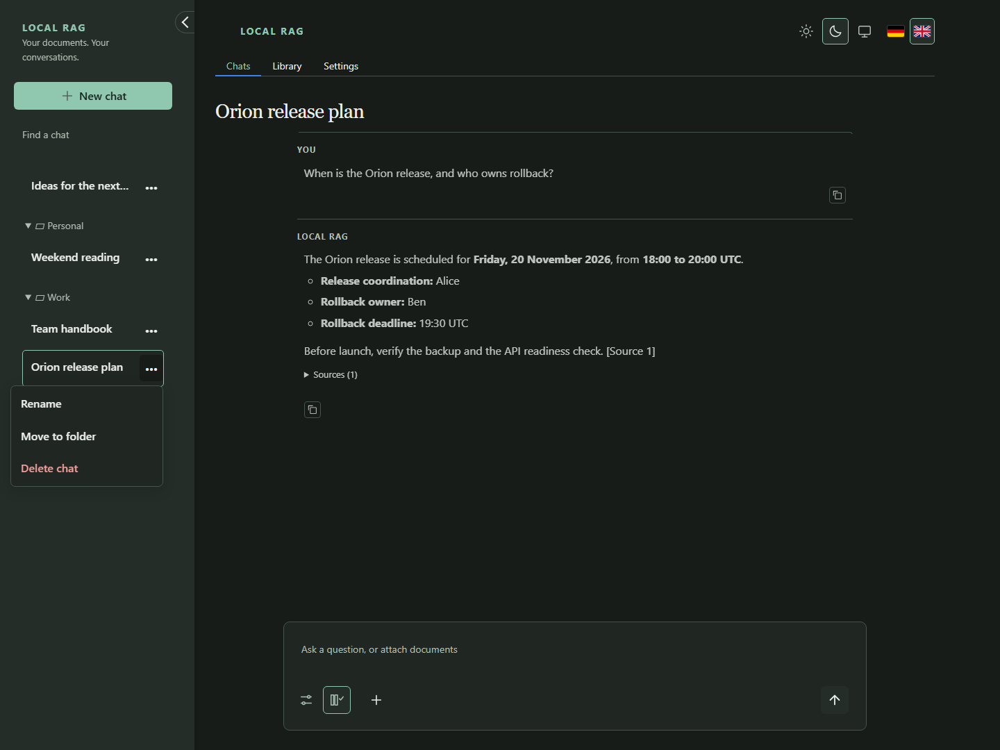
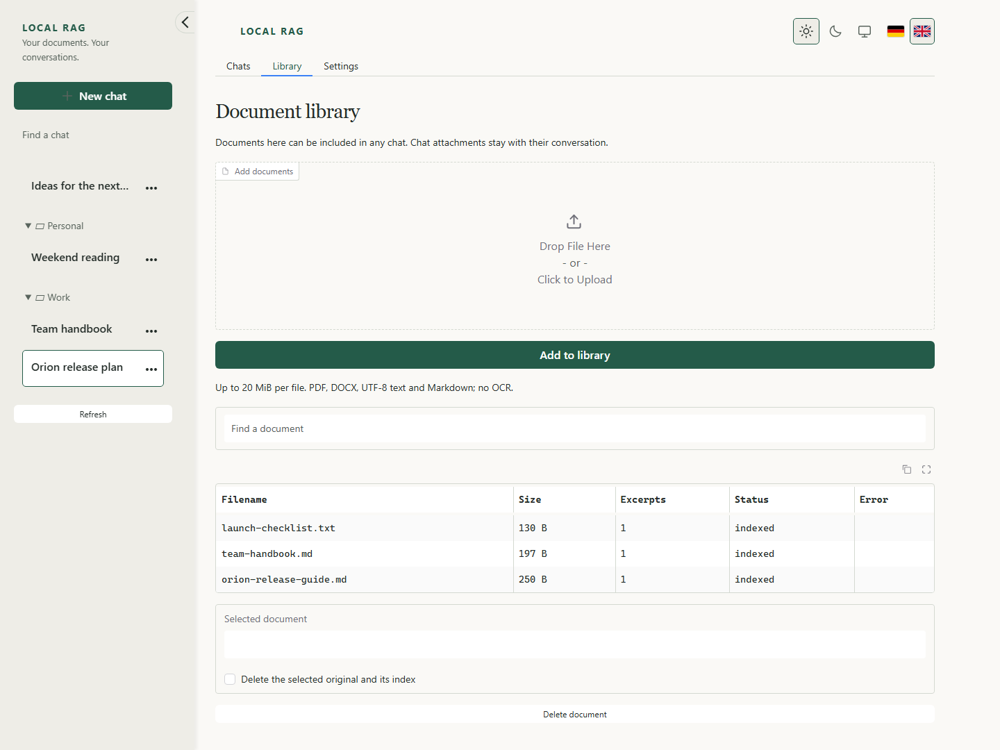

# Local RAG

[English (UK)](README.md) | **Deutsch**

[](https://github.com/DaniWunderlich/LocalRAG/releases/latest)
[](backend/pyproject.toml)
[](backend/pyproject.toml)
[](frontend/pyproject.toml)
[](deploy/compose.yaml)
[](#tests)

Chatte mit deinen Dokumenten, vollständig auf deiner eigenen Infrastruktur. Eine
Gradio-Oberfläche verbindet FastAPI, Qdrant und deine vorhandene Ollama-Installation.
Du brauchst kein Konto bei einem Cloud-KI-Anbieter.

Aktueller Release: **v0.3.0** – [Änderungsübersicht](CHANGELOG.md) (auf Englisch).

## Was du damit machen kannst

- Stelle einem lokalen Sprachmodell allgemeine Fragen oder hänge PDF-, DOCX-,
  TXT- und Markdown-Dateien an, um dokumentbasierte Antworten mit einsehbaren
  Quellenauszügen zu erhalten.
- Speichere separate Chats, benenne sie um, ordne sie in Ordner ein und lösche
  sie über das Menü in der Seitenleiste.
- Nutze private Chat-Anhänge oder beziehe gezielt Dokumente aus der gemeinsamen
  Bibliothek ein. Dateien, die andere Chats noch verwenden, bleiben beim Löschen
  eines Chats erhalten.
- Wechsle zwischen Deutsch und Englisch sowie heller, dunkler oder
  systemgesteuerter Darstellung.
- Sende mit **Enter**, füge mit **Umschalt+Enter** einen Zeilenumbruch ein und
  schreibe nach dem Absenden direkt im Eingabefeld weiter. Eine Warteanzeige
  erscheint, während das Modell arbeitet; fehlgeschlagene Fragen bleiben für
  einen erneuten Versuch erhalten.

## Ein Blick in die Anwendung

Echte Screenshots der Anwendung, aufgenommen mit Playwright in einer isolierten
Demo-Instanz. Dokumente, Gespräche und die vorbereitete Beispielantwort sind
fiktiv. Die Screenshots zeigen die englische Oberfläche.

**Chat und Quellen, helle Darstellung**



**Chat-Verwaltung, dunkle Darstellung**



**Gemeinsame Dokumentbibliothek**



## Start unter Windows oder Linux

Du brauchst Git, Docker mit Compose v2 und eine laufende Ollama-Instanz mit
einem installierten Chat-Modell und einem Embedding-Modell. Unter Windows kannst
du Docker Desktop mit Linux-Containern verwenden, unter Linux Docker Engine mit
dem Compose-Plugin. Modelldownloads und das Bauen der Images benötigen
Internetzugang; im normalen Betrieb werden deine lokalen Dienste angesprochen.

### 1. Repository klonen und konfigurieren

```sh
git clone https://github.com/DaniWunderlich/LocalRAG.git
cd LocalRAG
```

Kopiere die Beispielkonfiguration einmalig. Behalte beim Aktualisieren eine
bereits vorhandene `.env` bei.

Windows (PowerShell):

```powershell
if (-not (Test-Path .env)) { Copy-Item .env.example .env }
```

Linux (Bash):

```bash
[ -f .env ] || cp .env.example .env
```

Bearbeite `.env` in deinem Editor:

| Einstellung | Was du einträgst |
| --- | --- |
| `OLLAMA_BASE_URL` | `http://host.docker.internal:11434` für Ollama auf dem Docker-Host oder die lokale Netzwerk-URL deines Ollama-Servers |
| `OLLAMA_EMBEDDING_MODEL` | Ein installiertes Embedding-Modell; die Beispielkonfiguration verwendet `embeddinggemma:300m` |
| `OLLAMA_CHAT_MODEL` | Ein installiertes Chat-Modell oder leer lassen und ein Modell in der Oberfläche auswählen |
| `FRONTEND_PORT` | Port für den Browserzugriff, standardmäßig `8501` |
| `MAX_UPLOAD_BYTES` | Dateigrößenbegrenzung für Frontend und Backend, standardmäßig `20971520` (20 MiB) |

Compose stellt `host.docker.internal` auch unter Linux bereit. Ollama muss auf
einer Schnittstelle lauschen, die aus den Containern erreichbar ist. Wenn Ollama
nur an `127.0.0.1` gebunden ist, kann eine Anpassung nötig sein, insbesondere
unter Linux. Beschränke den Zugriff auf dein vertrauenswürdiges Netzwerk. Die
Anwendung lädt Modelle niemals automatisch herunter.

### 2. Anwendung starten

Derselbe Befehl funktioniert in PowerShell und Bash:

```sh
docker compose --env-file .env -f deploy/compose.yaml -p localrag up -d --build --wait
```

Öffne **[http://localhost:8501](http://localhost:8501)**, wähle ein Chat-Modell und
stelle eine Frage. Über das **+** im Eingabefeld kannst du Dokumente anhängen.
Gemeinsame Dokumente lädst du unter **Bibliothek** hoch und aktivierst für den
Chat **Gemeinsame Bibliothek einbeziehen**.

Nur die Browseroberfläche wird über die lokale Loopback-Adresse veröffentlicht.
Die Anwendung hat keine Authentifizierung; verwende sie in einer
vertrauenswürdigen lokalen Umgebung.

## Aktualisieren, stoppen und Fehler untersuchen

Führe nach dem Abrufen von Änderungen den Startbefehl erneut aus, um die Images
neu zu bauen. Ein einfacher Neustart übernimmt keine Änderungen am Quellcode.

```sh
git pull
docker compose --env-file .env -f deploy/compose.yaml -p localrag up -d --build --wait
```

Dienststatus oder Protokolle anzeigen:

```sh
docker compose --env-file .env -f deploy/compose.yaml -p localrag ps
docker compose --env-file .env -f deploy/compose.yaml -p localrag logs --tail=100
```

Stoppen und dabei gespeicherte Chats, Dokumente und den Vektorindex behalten:

```sh
docker compose --env-file .env -f deploy/compose.yaml -p localrag down
```

Füge kein `--volumes` hinzu, wenn du deine Daten behalten möchtest. Sichere die
Dokument- und Qdrant-Volumes gemeinsam. Ein Wechsel des Embedding-Modells
erfordert eine kontrollierte Neuindexierung.

## Grenzen

Uploads werden synchron indexiert, und Antworten erscheinen als vollständige
Nachrichten. Große Dokumente oder langsamere Modelle können Zeit benötigen.
Das aktuelle Backend verarbeitet Änderungen nacheinander und läuft als einzelne
Instanz. OCR und Authentifizierung sind nicht enthalten. Quellenauszüge zeigen
die dem Modell bereitgestellten Belege; die Antwortqualität und die korrekte
Quellenangabe hängen weiterhin vom gewählten Modell ab.

## Tests

Für [Backend](backend/tests) und [Frontend](frontend/tests) gibt es automatisierte
pytest-Tests. Der pytest-Badge zeigt das verwendete Testframework an. GitHub
Actions ist noch nicht eingerichtet, daher gibt es keinen Live-CI-Teststatus.
