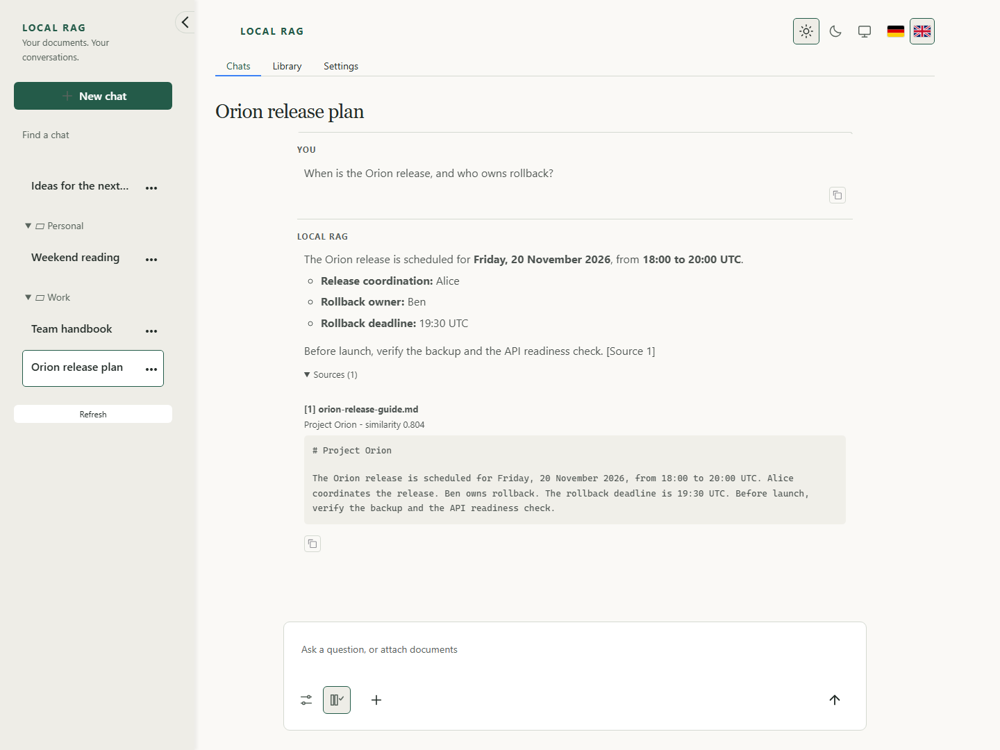
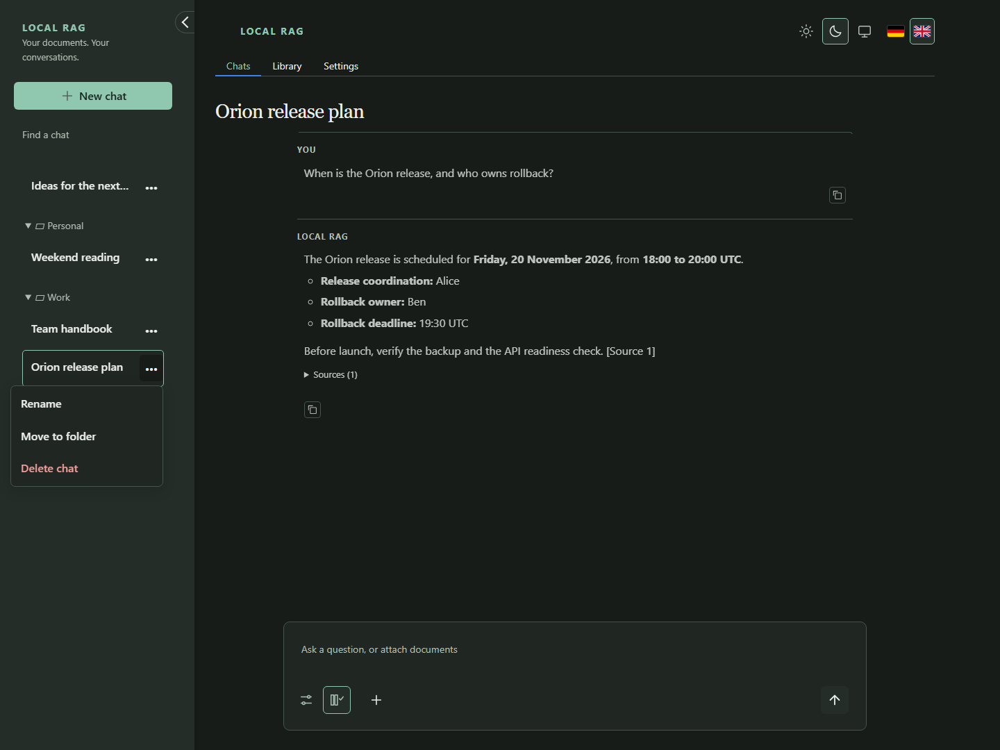
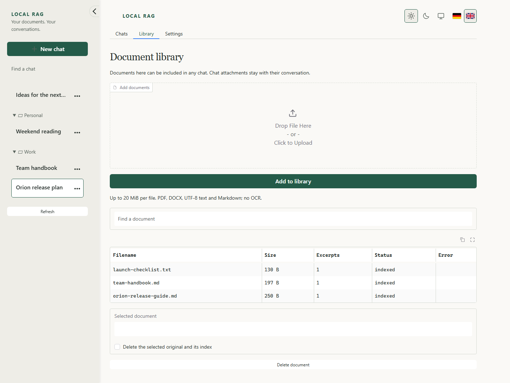

# Local RAG

Chat with your documents, entirely on your own infrastructure. A Gradio interface
connects FastAPI, Qdrant and your existing Ollama installation. No cloud AI account
is required.

Current release: **v0.3.0** - [Changelog](CHANGELOG.md).

## What you can do

- Ask a local LLM general questions, or attach PDF, DOCX, TXT and Markdown files
  for document-based answers with inspectable source excerpts.
- Keep separate saved chats, rename them, group them in folders and delete them
  through the sidebar menu.
- Use private chat attachments or deliberately include documents from the shared
  library. Files still used by other chats are retained when a chat is deleted.
- Switch between German and English and Light, Dark or System appearance.
- Send with **Enter**, add a line with **Shift+Enter**, and keep focus in the
  composer when sending. A waiting indicator appears while the model works; failed questions
  remain available for retry.

## A look inside

Real application screenshots captured with Playwright in an isolated demo
instance. Documents, conversations and the prepared example answer are fictional.

**Chat and sources, light appearance**



**Chat management, dark appearance**



**Shared document library**



## Start on Windows or Linux

You need Git, Docker with Compose v2, and a running Ollama instance with a local
chat model and an embedding model installed. Windows users can use Docker Desktop
with Linux containers; Linux users can use Docker Engine with the Compose plugin.
Model downloads and image builds need internet access; normal use calls your
local services.

### 1. Clone and configure

```sh
git clone https://github.com/DaniWunderlich/LocalRAG.git
cd LocalRAG
```

Copy the example configuration once, keeping an existing `.env` when updating.

Windows (PowerShell):

```powershell
if (-not (Test-Path .env)) { Copy-Item .env.example .env }
```

Linux (Bash):

```bash
[ -f .env ] || cp .env.example .env
```

Edit `.env` in your editor:

| Setting | What to enter |
| --- | --- |
| `OLLAMA_BASE_URL` | `http://host.docker.internal:11434` for Ollama on the Docker host, or your Ollama server's local network URL |
| `OLLAMA_EMBEDDING_MODEL` | An installed embedding model; the example defaults to `embeddinggemma:300m` |
| `OLLAMA_CHAT_MODEL` | An installed chat model, or leave blank and select one in the interface |
| `FRONTEND_PORT` | Browser port, default `8501` |
| `MAX_UPLOAD_BYTES` | Per-file limit shared by frontend and backend, default `20971520` (20 MiB) |

Compose maps `host.docker.internal` on Linux too. Ollama must listen on an
interface reachable from the containers; a host-only `127.0.0.1` listener may
need adjusting, especially on Linux. Keep its access restricted to your trusted
network. The app never downloads models automatically.

### 2. Start the application

The same command works in PowerShell and Bash:

```sh
docker compose --env-file .env -f deploy/compose.yaml -p localrag up -d --build --wait
```

Open **[http://localhost:8501](http://localhost:8501)**, choose a chat model, and ask
a question. Use the **+** in the composer to attach documents, or upload shared
documents under **Library** and enable **Include library** for the chat.

Only the browser interface is published, on loopback. The app has no
authentication; use it in a trusted local environment.

## Update, stop and troubleshoot

After pulling changes, run the start command again to rebuild. A plain restart
does not pick up source changes.

```sh
git pull
docker compose --env-file .env -f deploy/compose.yaml -p localrag up -d --build --wait
```

Inspect service status or logs:

```sh
docker compose --env-file .env -f deploy/compose.yaml -p localrag ps
docker compose --env-file .env -f deploy/compose.yaml -p localrag logs --tail=100
```

Stop while keeping saved chats, documents and the vector index:

```sh
docker compose --env-file .env -f deploy/compose.yaml -p localrag down
```

Do not add `--volumes` when keeping your data. Back up the document and Qdrant
volumes together. Changing the embedding model requires a controlled reindex.

## Limits

Uploads are indexed synchronously, and answers arrive as complete responses.
Large documents or slower models can take time. The current backend serializes
mutations and runs as a single instance. OCR and authentication are not included.
Source excerpts show the evidence supplied to the model; answer quality and
citation compliance still depend on the chosen model.
